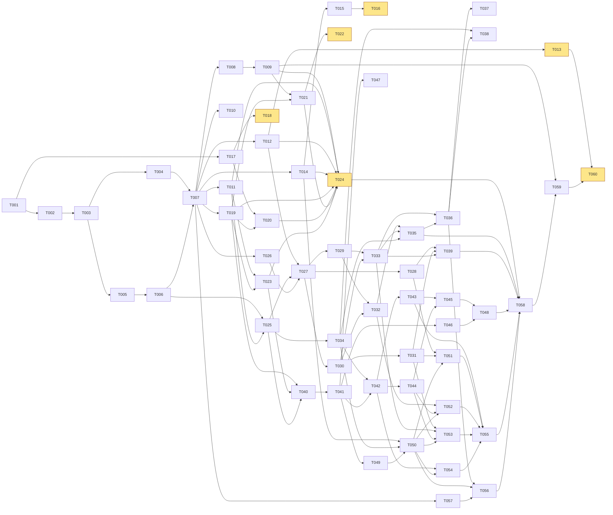
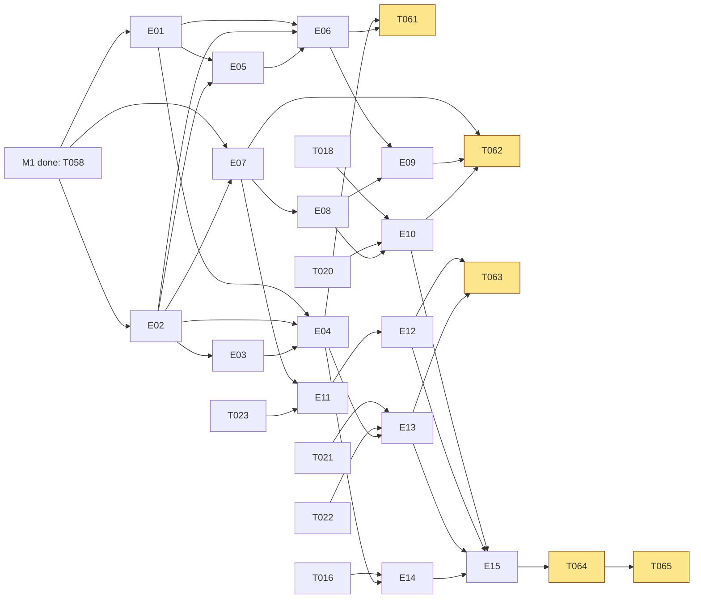

# Full Theta: implementation DAG

Plan of GitHub issues for the whole game (FT-TST-018), built from spec v0.4 and decisions D1–D92. Repo: migueltorrescosta/full-theta. Date: 2026-10-19.

Conventions (D73–D75):

- Every row below becomes one issue and at most one PR. IDs are planning ids; the issue body carries `Depends on: #N` and native "blocked by" links, and epics hold their tasks as sub-issues.
- M0 and M1 are PR-sized tasks. M2–M5 are one epic per area with an outlined task list, split into PR-sized issues once M1 lands.
- Owner-only steps are separate issues titled "... (owner step)", Host Human, assigned to the owner, "Agents: do not claim".
- Spec paths are given as they will sit in the repo after T001: `docs/spec/NN-*.md` (cited as "spec §N"), `docs/decisions.md`, `docs/research/station-ui.md`, `docs/research/pairs-and-combos.md`, `docs/research/tech.md`, `docs/research/emptyepsilon.md`.
- Every issue lists its FT ids (FT-TST-017); every test names the FT ids it verifies (FT-TST-016); `docs/traceability.md` maps ids to tests (FT-TST-015).
- Spikes are time-boxed, write a short report to `docs/spikes/Sn.md` and keep code under `spikes/` until promoted or deleted. A spike that misses its pass criterion blocks its dependants until the owner approves the fallback in T024.

## 1. Issue table

| ID | Title | Milestone | Labels | Depends on | Requirements | Host |
|---|---|---|---|---|---|---|
| T001 | Repo bootstrap: docs | M0 | docs | — | FT-GEN-014, FT-LIC-001, FT-LIC-003, FT-LIC-004, FT-TST-017, FT-TST-018 | |
| T002 | Add pinned Godot 4.7.2 fetch script with checksums (S0) | M0 | ci | T001 | FT-ARC-001 | |
| T003 | Create Godot project skeleton and module layout | M0 | ci, sim, net, ui | T002 | FT-ARC-002, FT-ARC-003 | |
| T004 | Vendor gdUnit4 at a pinned tag with a sample test | M0 | ci | T003 | FT-TST-001 | |
| T005 | Add gdtoolkit lint, format and parse checks | M0 | ci | T003 | FT-TST-002 | |
| T006 | Add architecture lint for sim/ and director/ purity | M0 | ci, sim | T005 | FT-ARC-010, FT-ARC-011 | |
| T007 | Add local gate script with L0–L3 tiers | M0 | ci | T004, T006 | FT-TST-002, FT-TST-005 | |
| T008 | Add single-job CI workflow for ready PRs | M0 | ci | T007 | FT-TST-004 | |
| T009 | S1: clean-clone import, tests and exports; add L6 export gate | M0 | ci | T008 | FT-GEN-012 | |
| T010 | Add traceability map and FT-id gate | M0 | ci, docs | T007 | FT-TST-015, FT-TST-016, FT-TST-017 | |
| T011 | S6: benchmark GDScript sim at 100 ships, 500 projectiles | M0 | sim | T007 | FT-ARC-006, FT-ARC-009 | |
| T012 | S5: build 6DOF Helm flight prototype | M0 | sim, ui | T007 | FT-SIM-001, FT-SIM-004, FT-SIM-005 | |
| T013 | S5 Helm prototype playtest (owner step) | M0 | sim, ui | T012 | FT-SIM-004 | Human |
| T014 | S2: llvmpipe screenshot harness under Xvfb | M0 | ci, ui | T007 | FT-TST-003 | |
| T015 | S8: render a procedural toon-shaded ship through S2 | M0 | ui, content | T014 | FT-AUD-016 | |
| T016 | Approve art style direction (owner step) | M0 | ui | T015 | FT-AUD-016 | Human |
| T017 | S7: render Piper lines in en, pt_PT, it and audit licences | M0 | audio | T001 | FT-AUD-001, FT-AUD-004, FT-AUD-012, FT-AUD-014, FT-LIC-007 | |
| T018 | Approve Piper voices per language (owner step) | M0 | audio | T017 | FT-AUD-012, FT-LIC-007 | Human |
| T019 | S4: WebSocket snapshots under loss, with token reconnect | M0 | net | T007 | FT-NET-004, FT-NET-025 | |
| T020 | S7b: runtime Piper on the host, clip streamed to one client | M0 | audio, net | T017, T019 | FT-ARC-019, FT-AUD-015, FT-AUD-018 | |
| T021 | S3: single-threaded web export of one station over WS | M0 | net, ui, ci | T009, T019 | FT-NET-030, FT-AUD-017 | |
| T022 | Test browser station and LAN join on owner devices (owner step) | M0 | net, ui | T021 | FT-NET-013, FT-STN-005 | Human |
| T023 | S9: load test 6 ships, 36 crew, 28 viewers on loopback | M0 | net, sim | T011, T019 | FT-GEN-001, FT-GEN-003 | |
| T024 | Approve M0 spike outcomes and architecture (owner step) | M0 | docs | T009, T011, T012, T014, T019, T020, T021, T023 | FT-ARC-015 | Human |
| T025 | Add sim core: fixed 60 Hz tick, seeded RNG, ship/faction keys | M1 | sim | T006, T011 | FT-ARC-004, FT-ARC-006, FT-ARC-008, FT-ARC-009, FT-ARC-012, FT-M1-014 | |
| T026 | Add typed .tres definitions and the definition load gate | M1 | content, ci | T007 | FT-DAT-001, FT-DAT-002, FT-DAT-013, FT-SIM-002, FT-SIM-033 | |
| T027 | Implement the 6DOF integrator with analytic tests | M1 | sim | T012, T025, T026 | FT-SIM-001–003, FT-ARC-007, FT-TST-007, FT-M1-003 | |
| T028 | Add flight assist, decoupled, face assist, Level, propellant | M1 | sim | T027 | FT-SIM-004, FT-SIM-005, FT-SIM-007, FT-HLM-005–007, FT-M1-003 | |
| T029 | Add collisions with swept projectiles and proximity warning | M1 | sim | T027 | FT-SIM-009, FT-SIM-010 | |
| T030 | Add power pips, heat and thrust envelope (PWR) | M1 | sim | T027 | FT-SIM-006, FT-SIM-026 | |
| T031 | Add shields with focus direction, power and tightness | M1 | sim | T030 | FT-SIM-017–019, FT-SIM-031 | |
| T032 | Add weapon mounts, arcs, lead and projectile fire | M1 | sim | T029, T030 | FT-SIM-011, FT-SIM-012, FT-SIM-014, FT-SIM-016, FT-TST-008 | |
| T033 | Add hit-location damage and repair crews with spare parts | M1 | sim | T029, T030 | FT-SIM-020, FT-SIM-021, FT-SIM-024, FT-M1-009 | |
| T034 | Add faction knowledge, callsigns and clock/height/range | M1 | sim | T025 | FT-ARC-013, FT-SPA-001, FT-SPA-002, FT-SPA-004 | |
| T035 | Add enemy AI: attack, keep range, retreat | M1 | sim | T032, T033, T034 | FT-SIM-027, FT-SIM-028, FT-M1-007 | |
| T036 | Add event stream, encounter outcome and run reset | M1 | sim | T033, T035 | FT-SIM-030, FT-MIS-017, FT-GEN-010, FT-M1-012 | |
| T037 | Add golden replay recording and tests | M1 | sim, ci | T036 | FT-TST-009, FT-ARC-008 | |
| T038 | Add headless 2-ship PvP simulation test | M1 | sim | T034, T036 | FT-TST-013, FT-GEN-002, FT-M1-014 | |
| T039 | Build pair test harness and the P1 Engineering + Helm test | M1 | sim | T028, T031, T033 | FT-PAIR-004, FT-PAIR-015, FT-TST-006, FT-M1-010 | |
| T040 | Define protocol messages, handshake and codec | M1 | net | T019, T023, T025 | FT-NET-004, FT-NET-005, FT-NET-011 | |
| T041 | Add server session: command validation, 30 Hz snapshots | M1 | net | T040 | FT-NET-002, FT-NET-006–008, FT-ARC-005 | |
| T042 | Add station definitions and per-station snapshot filter | M1 | net | T034, T041 | FT-ARC-014, FT-NET-009, FT-NET-010, FT-TST-010, FT-PAIR-005, FT-M1-005 | |
| T043 | Add lobby catalogue, coverage check, dev all-stations flag | M1 | net, ui | T042 | FT-NET-015–017, FT-NET-019–021, FT-NET-029, FT-GEN-004–007, FT-M1-015 | |
| T044 | Add claims on shared sub-controls | M1 | net | T042 | FT-NET-022–024 | |
| T045 | Add reconnect token, 10 s grace and universe pause | M1 | net | T043, T044 | FT-NET-025–027, FT-NET-033–036, FT-M1-013 | |
| T046 | Add Host button child server and 64-connection cap | M1 | net, ui | T041 | FT-NET-001, FT-NET-003, FT-NET-014, FT-GEN-003, FT-M1-002 | |
| T047 | Add LAN discovery broadcast and manual IP join | M1 | net, ui | T041 | FT-NET-012, FT-NET-013, FT-NET-031, FT-GEN-013 | |
| T048 | Add L4 multi-process network test pinned to 2 cores | M1 | net, ci | T045, T046 | FT-TST-011, FT-TST-014 | |
| T049 | Add client shell, snapshot interpolation, rebindable input | M1 | ui, net | T041 | FT-STN-005, FT-STN-007, FT-ARC-015 | |
| T050 | Add common station UI: top bar, alert level, disc radar | M1 | ui | T014, T034, T049 | FT-STN-001–003, FT-STN-006, FT-STN-008, FT-SPA-003, FT-SPA-005, FT-SPA-007–011 | |
| T051 | Build the Helm station | M1 | ui | T028, T031, T050 | FT-HLM-001–012, FT-M1-004 | |
| T052 | Build the Weapons station | M1 | ui | T032, T044, T050 | FT-WPN-001–006, FT-SIM-015, FT-M1-004, FT-M1-008 | |
| T053 | Build the Engineering station | M1 | ui | T031, T033, T044, T050 | FT-ENG-001–005, FT-ENG-007, FT-M1-004 | |
| T054 | Add Science, Relay, Comms placeholders and viewer main screen | M1 | ui | T042, T050 | FT-M1-005, FT-MSC-001, FT-MSC-004, FT-NET-028 | |
| T055 | Build the Tactical, Systems and Ops joint views | M1 | ui | T043, T051–T054 | FT-JNT-001–003, FT-NET-018, FT-M1-006 | |
| T056 | Add event notifications and alert tones | M1 | ui, audio | T036, T050, T057 | FT-STN-004, FT-SIM-032, FT-AUD-009, FT-M1-011 | |
| T057 | Add provenance manifest and licence gate | M1 | ci, docs, content | T007 | FT-LIC-002, FT-LIC-005, FT-LIC-006, FT-DAT-012 | |
| T058 | Assemble the M1 encounter end to end with three clients | M1 | sim, net, ui | T024, T035, T039, T048, T055, T056 | FT-M1-001, FT-M1-012 | |
| T059 | Write launch docs for host, client and dedicated server | M1 | docs | T009, T058 | FT-M1-016 | |
| T060 | First playable playtest with three players (owner step) | M1 | docs | T013, T059 | FT-M1-001 | Human |
| E01 | Epic: Science station, scans and hacks | M2 | sim, net, ui | T058 | FT-SCI-001–013, FT-SIM-022, FT-SIM-023 | |
| E02 | Epic: Relay station, marks, pings and probes | M2 | sim, net, ui | T058 | FT-RLY-001–009, FT-SPA-006, FT-SPA-012–017, FT-SPA-020–022, FT-STN-003 | |
| E03 | Epic: Captain seat and main screen views | M2 | net, ui | E02 | FT-CPT-001–003, FT-MSC-001–005, FT-RLY-010 | |
| E04 | Epic: remaining 12 joint views and full catalogue | M2 | ui, net | E01, E02, E03 | FT-JNT-004, FT-NET-017, FT-NET-032 | |
| E05 | Epic: data shortcut toggles and difficulty presets | M2 | net, ui | E01, E02 | FT-PAIR-007–009, FT-PAIR-012–014, FT-PAIR-017–020, FT-SPA-019, FT-WPN-007, FT-MIS-008 | |
| E06 | Epic: pairs P2–P4, P6–P8, P10, P11, P13 with pair tests | M2 | sim, ui | E01, E02, E05 | FT-PAIR-001, FT-PAIR-003, FT-PAIR-004, FT-PAIR-015, FT-SIM-013, FT-SIM-025, FT-ENG-006, FT-TST-006 | |
| T061 | Full-crew playtest with six players (owner step) | M2 | docs | E04, E06 | FT-PAIR-001 | Human |
| E07 | Epic: Scenario API, global map, sites and director | M3 | sim, content | T058, E02 | FT-DAT-006–010, FT-MIS-001, FT-MIS-003–006, FT-MIS-009, FT-MIS-010, FT-MIS-024–029, FT-ARC-016, FT-TST-012, FT-SIM-029, FT-SIM-034, FT-HLM-013, FT-GEN-009, FT-GEN-011 | |
| E08 | Epic: Comms card board, dialogue, economy and modules | M3 | sim, net, ui, content | E07 | FT-COM-001–009, FT-DAT-003, FT-DAT-004, FT-DAT-014, FT-MIS-015, FT-MIS-016, FT-MIS-018–022, FT-MIS-035, FT-MIS-036, FT-PAIR-010, FT-PAIR-011 | |
| E09 | Epic: pairs P5, P9, P12, P14, P15 with pair tests | M3 | sim, ui | E06, E08 | FT-PAIR-001, FT-PAIR-002, FT-PAIR-004, FT-PAIR-015, FT-TST-006 | |
| E10 | Epic: voice bus, Piper TTS, languages and subtitles | M3 | audio, content, ci | T018, T020, E08 | FT-AUD-001–015, FT-AUD-018, FT-ARC-019, FT-DAT-005, FT-DAT-011, FT-GEN-008 | |
| T062 | Death-risk tuning playtests (owner step) | M3 | docs | E07, E09, E10 | FT-MIS-009, FT-GEN-011 | Human |
| E11 | Epic: multi-ship sessions, allied factions, elimination | M4 | sim, net, ui | E07, T023 | FT-GEN-001, FT-GEN-003, FT-ARC-018, FT-MIS-011–013, FT-MIS-023, FT-MIS-030, FT-SPA-023, FT-TST-011 | |
| E12 | Epic: PvP scenario types (race, last standing, teams) | M4 | sim, content | E11 | FT-MIS-014, FT-MIS-031–034, FT-PAIR-016, FT-GEN-002 | |
| E13 | Epic: browser stations over HTTP with touch layouts | M4 | net, ui, audio, ci | T021, T022, E04 | FT-NET-013, FT-NET-030, FT-STN-005, FT-AUD-017, FT-SCI-013 | |
| T063 | Multi-ship PvP LAN playtest with tablets (owner step) | M4 | docs | E12, E13 | FT-GEN-001, FT-GEN-003 | Human |
| E14 | Epic: presentation, toon art, VFX and CC0 sound | M5 | ui, audio, content | T016, E04 | FT-AUD-016, FT-LIC-006, FT-STN-006 | |
| E15 | Epic: release packaging for Linux, Windows and macOS | M5 | ci, docs | E10, E12, E13, E14 | FT-ARC-017, FT-GEN-012, FT-LIC-004, FT-LIC-005, FT-LIC-008 | |
| T064 | macOS test machine, signing and notarisation (owner step) | M5 | ci | E15 | FT-ARC-017 | Human |
| T065 | Windows smoke test and release approval (owner step) | M5 | ci | E15, T064 | FT-GEN-012 | Human |

## 2. Issues

### M0 Spikes

#### T001 Repo bootstrap: docs
- **Why:** Agents need the spec, decisions and conventions in the repo before any code; the repo holds only README and LICENSE.
- **Verification criteria:**
  - [ ] `docs/spec/` holds spec v0.4 (README + 14 files); `docs/decisions.md`, `docs/research/station-ui.md`, `docs/research/pairs-and-combos.md`, `docs/research/emptyepsilon.md`, `docs/research/tech.md`, `docs/plan/task-breakdown.md` present.
  - [ ] `CLAUDE.md` and `AGENTS.md` state conventions: typed GDScript, `sim/` purity, FT ids in issues/tests, draft PRs, local gates, one PR per issue, no EE code (FT-LIC-002).
  - [ ] `docs/provenance.md` seeded with spec §13.2 (reproduced/redesigned/omitted) and a statement that the EE clone stays outside the repo.
  - [ ] `grep -c '^- \*\*FT-' docs/spec/*.md` totals 330 active ids; LICENSE is GPL-3.0.
- **Instructions:** Copy files unchanged from the planning workspace; fix only relative links. Keep CLAUDE.md short and pointing to spec files (docs point, don't copy). AGENTS.md may be a symlink to CLAUDE.md.
- **Risks/approvals:** Spec text enters a public repo; nothing in it is private.

#### T002 Add pinned Godot 4.7.2 fetch script with checksums (S0)
- **Why:** R0: every gate and CI run needs the exact engine and export templates.
- **Verification criteria:**
  - [ ] `tools/godot-version` holds `4.7.2-stable`; `tools/get-godot.sh` downloads the Linux headless binary and export templates to a cache dir and verifies SHA-512 sums committed in `tools/godot.sha512`.
  - [ ] A tampered checksum makes the script exit non-zero (scripted check).
  - [ ] `godot --version` prints 4.7.2 on fugaku from a clean cache.
- **Instructions:** Use the official GitHub release assets; record URLs and hashes. Also record the gdtoolkit and gdUnit4 versions verified by S0 in `docs/spikes/S0.md` (Piper is verified in T017).

#### T003 Create Godot project skeleton and module layout
- **Why:** Fixes the folder layout and renderer that every later task builds on.
- **Verification criteria:**
  - [ ] `project.godot` uses the Compatibility renderer and treats untyped declarations as errors (FT-ARC-002, 003).
  - [ ] Folders of research/tech §8.2 exist (`sim/ director/ net/ stations/ input/ presentation/ audio/ app/ content/ tests/ tools/`), each with a README line.
  - [ ] `godot --headless --import` then `godot --headless --path . -- --server` exits 0 (stub server entry).
- **Instructions:** Repo root = project root. `app/server_main.gd` parses CLI args (`--server`, `--port`, `--dev-all-stations` placeholder). No gameplay code.

#### T004 Vendor gdUnit4 at a pinned tag with a sample test
- **Why:** FT-TST-001; all later verification runs through it.
- **Verification criteria:**
  - [ ] `addons/gdUnit4/` vendored at a tag compatible with 4.7.2, recorded in `addons/VERSIONS.md`.
  - [ ] A sample test tagged `FT-TST-001` passes headless and writes a JUnit report; a failing test makes the command exit non-zero.
- **Instructions:** Use the headless command in research/tech §7.1. Add `tests/README.md` with the convention for naming FT ids in tests (consumed by T010).

#### T005 Add gdtoolkit lint, format and parse checks
- **Why:** L0 static layer (spec §12.1) catches errors without a GPU.
- **Verification criteria:**
  - [ ] gdtoolkit pinned via `uv` (`tools/pyproject.toml`, `uv.lock`); `.gdlintrc` committed.
  - [ ] `gdlint`, `gdformat --check` and `godot --headless --check-only` over all scripts pass; a seeded bad file fails each.
- **Instructions:** Wire as `tools/l0.sh`; T007 calls it.

#### T006 Add architecture lint for sim/ and director/ purity
- **Why:** FT-ARC-010/011: the sim must stay pure so tests, server and replays agree.
- **Verification criteria:**
  - [ ] `tools/lint_arch.py` fails on `extends Node`, SceneTree access, `FileAccess`/`OS`/network calls in `sim/`, `director/`, `missions/`, and on any `stations/`, `input/`, `presentation/` reference to `sim/`.
  - [ ] Its own tests cover each forbidden pattern with a fixture (pass and fail).
- **Instructions:** Rules in spec §2.2 and research/tech §8.1. Allow `content/` definitions. Add the scenario API lint (FT-DAT-007) later in E07.

#### T007 Add local gate script with L0–L3 tiers
- **Why:** One command for agents and CI (FT-TST-005); L4–L6 slots are added by later tasks.
- **Verification criteria:**
  - [ ] `tools/gate.sh [l0|l1|l2|l3|l4|l5|l6|ci|all]` runs `--import` first, then the tiers; `make gate` wraps it.
  - [ ] `gate.sh ci` passes on a clean checkout on fugaku with no GPU (FT-TST-002).
  - [ ] Unknown or not-yet-implemented tiers exit with a clear message, not success.
- **Instructions:** Prints the commit hash and tier results in a block the PR body can quote.

#### T008 Add single-job CI workflow for ready PRs
- **Why:** FT-TST-004 with minimal Actions minutes (research/tech §7.3).
- **Verification criteria:**
  - [ ] `.github/workflows/ci.yml`: one job, skips drafts, `paths-ignore` docs, `concurrency: cancel-in-progress`, caches Godot keyed on `tools/godot-version`, runs `gate.sh ci`.
  - [ ] One run on the PR is green; its wall time and billed minutes are recorded in the PR body (target ≤ 5 min).
- **Instructions:** The repo is public, so minutes are free, but keep the one-job design.

#### T009 S1: clean-clone import, tests and exports; add L6 export gate
- **Why:** R1: proves the headless agent workflow end to end and fixes the export path.
- **Verification criteria:**
  - [ ] From a fresh clone: import, gdUnit4 run, Linux and Windows exports succeed from the CLI (`docs/spikes/S1.md` with timings).
  - [ ] `export_presets.cfg` committed; `gate.sh l6` exports both and runs the Linux build headless for 5 s with exit 0.
  - [ ] Cold and warm import times recorded.
- **Instructions:** Windows is cross-built only; its runtime smoke test is an owner step (T065). macOS export is attempted and its result recorded (FT-ARC-017 risk).

#### T010 Add traceability map and FT-id gate
- **Why:** FT-TST-015–017: every requirement must trace to a test or "manual".
- **Verification criteria:**
  - [ ] `tools/traceability.py` parses active ids from `docs/spec/*.md` and FT tags from `tests/`, and writes `docs/traceability.md` (id → tests | manual | pending).
  - [ ] `gate.sh l0` fails if `docs/traceability.md` is stale, a test names an unknown or removed id, or an id marked manual lacks an issue link.
  - [ ] Removed (struck-through) ids are excluded.
- **Instructions:** "pending" is allowed until the milestone that delivers the id closes; the M1 closing check (T058) requires no pending FT-M1 ids.

#### T011 S6: benchmark GDScript sim at 100 ships, 500 projectiles
- **Why:** R6 decides whether the sim stays pure GDScript (FT-ARC-002) or needs a GDExtension hot path.
- **Verification criteria:**
  - [ ] A spike sim with 100 ships, 500 swept projectiles at 60 Hz runs headless pinned to 1 core (`taskset -c 0`).
  - [ ] Mean and p99 tick time reported in `docs/spikes/S6.md`; pass is < 4 ms per tick.
- **Instructions:** Plain RefCounted entities ordered by id; packed arrays where it helps. The data layout that wins feeds T025.
- **Risks/approvals:** A fail changes the architecture: T024 must approve the fallback.

#### T012 S5: build 6DOF Helm flight prototype
- **Why:** R5 (high likelihood, high impact): 6DOF may be unplayable.
- **Verification criteria:**
  - [ ] Prototype scene: one ship, one moving target, assist and decoupled modes, face assist, KB/M and controller.
  - [ ] Headless test: with assist, a scripted autopilot input intercepts the target within 60 s.
  - [ ] Linux export of the prototype available for the owner (link in the issue).
- **Instructions:** Spec §4 FT-SIM-001–007 and station-ui Helm section. Integrator here is throwaway but keep it pure for promotion to T027.

#### T013 S5 Helm prototype playtest (owner step)
- **Why:** Only the owner can judge if flight is fun (R5).
- **Verification criteria:**
  - [ ] Owner intercepts the target in < 60 s with assist; result and feedback recorded in the issue.
- **Instructions:** Agents: do not claim. Feedback becomes tuning input for T028.

#### T014 S2: llvmpipe screenshot harness under Xvfb
- **Why:** R2: agents can't see the screen; L5 tests need stable software rendering (FT-TST-003).
- **Verification criteria:**
  - [ ] `gate.sh l5` renders a test scene under Xvfb with llvmpipe and diffs against a baseline with a tolerance.
  - [ ] 10 repeats are stable within tolerance; each shot < 30 s (`docs/spikes/S2.md`).
- **Instructions:** Baselines in `tests/visual/baselines/`; a `--update-baselines` flag regenerates them.

#### T015 S8: render a procedural toon-shaded ship through S2
- **Why:** R11: cartoon art without an artist.
- **Verification criteria:**
  - [ ] A procedural or CC0 ship with toon shader and outline rendered from 3 angles through the T014 harness; screenshots attached to the issue.
  - [ ] Any CC0 asset listed with source and licence.
- **Instructions:** Spec §9 FT-AUD-016; Compatibility renderer only.

#### T016 Approve art style direction (owner step)
- **Why:** Style is an owner judgement (R11).
- **Verification criteria:**
  - [ ] Owner picks or rejects a style from T015 screenshots; decision recorded in `docs/decisions.md` by a follow-up agent PR.
- **Instructions:** Agents: do not claim.

#### T017 S7: render Piper lines in en, pt_PT, it and audit licences
- **Why:** R7/R8: voice quality and licences gate all audio work.
- **Verification criteria:**
  - [ ] Piper release pinned (`tools/tts/` with uv lock); 20 representative lines per language rendered with 2 voices each, plus robotic-filtered ship-computer samples.
  - [ ] Licence audit table from each MODEL_CARD; non-commercial or unclear voices excluded (FT-LIC-007).
  - [ ] Real-time factor per voice on fugaku recorded in `docs/spikes/S7.md`; samples attached (not committed).
- **Instructions:** Include stitched numbers and names in pt_PT and it (R8). Generated audio is never committed (FT-AUD-002).

#### T018 Approve Piper voices per language (owner step)
- **Why:** Owner listens and approves ≥ 1 voice per launch language.
- **Verification criteria:**
  - [ ] One approved voice per language (en, pt_PT, it) and one ship-computer voice recorded in the issue.
- **Instructions:** Agents: do not claim.

#### T019 S4: WebSocket snapshots under loss, with token reconnect
- **Why:** R4/R9: the custom WS protocol (FT-NET-004) must hold up before the net stack is built.
- **Verification criteria:**
  - [ ] Spike server + 8 headless clients, 30 Hz snapshots, 2 % loss via `tc netem` on loopback: p99 snapshot age < 150 ms.
  - [ ] A client killed and restarted with its token resumes within 2 s.
  - [ ] Results in `docs/spikes/S4.md`, run pinned to 2 cores.
- **Instructions:** Use Godot `WebSocketPeer`/`TCPServer`; JSON or binary codec, whichever is quicker; T040 decides the final codec.
- **Risks/approvals:** A fail (e.g. switching transport) changes the architecture: T024.

#### T020 S7b: runtime Piper on the host, clip streamed to one client
- **Why:** R8/FT-AUD-015: dynamic lines must be audible < 1 s after the event.
- **Verification criteria:**
  - [ ] The headless server process synthesises a line with the T017 Piper build and streams it over the T019 socket to exactly one client.
  - [ ] Event-to-audible latency measured over 50 lines: p95 < 1 s on fugaku.
- **Instructions:** Piper runs as a subprocess of the server (FT-ARC-019); record the GPL aggregation note in provenance.

#### T021 S3: single-threaded web export of one station over WS
- **Why:** R3: browser stations (D8) may be infeasible.
- **Verification criteria:**
  - [ ] No-thread web export of a minimal Engineering panel served over plain HTTP by the spike server; connects over WS.
  - [ ] Headless Chromium (Playwright) loads it, joins in < 10 s and keeps ≥ 30 fps over 30 s.
  - [ ] Audio plays after a simulated tap (FT-AUD-017).
- **Instructions:** Reuse T019 transport. Device testing is T022.

#### T022 Test browser station and LAN join on owner devices (owner step)
- **Why:** Real tablets and the owner's Wi-Fi (R3, R10) can't be tested on fugaku.
- **Verification criteria:**
  - [ ] T021 build on an iPad and an Android tablet: join < 10 s, touch and audio work.
  - [ ] Join works on the owner's LAN by at least one route (discovery, IP or URL).
- **Instructions:** Agents: do not claim.

#### T023 S9: load test 6 ships, 36 crew, 28 viewers on loopback
- **Why:** R15: the 64-connection cap (FT-GEN-003) must fit the tick and snapshot budgets.
- **Verification criteria:**
  - [ ] 64 simulated connections across 6 ships on loopback, 2 cores: server tick < 8 ms, p99 snapshot age < 150 ms.
  - [ ] Report in `docs/spikes/S9.md` with CPU and bandwidth per client.
- **Instructions:** Combine the T011 sim load with the T019 transport; viewers get main-screen-sized snapshots.

#### T024 Approve M0 spike outcomes and architecture (owner step)
- **Why:** Spike results that change the stack (GDExtension, transport, prediction, browser scope) need the owner.
- **Verification criteria:**
  - [ ] Owner reviews S1–S9 reports; every failed criterion has an approved fallback recorded as a new decision in `docs/decisions.md`.
  - [ ] If all spikes pass, the owner closes the issue with "no change".
- **Instructions:** Agents: do not claim. M1 work starts in parallel; only T058 waits on this.

### M1 First playable

#### T025 Add sim core: fixed 60 Hz tick, seeded RNG, ship/faction keys
- **Why:** Foundation for every sim system (FT-ARC-004, 006, 008, 009, 012).
- **Verification criteria:**
  - [ ] `sim/core`: World with entities ordered by id, own accumulator stepping at 60 Hz, per-subsystem seeded RNG.
  - [ ] Tests: same seed + commands give identical state hashes over 1,000 ticks; iteration order is by id.
  - [ ] Every state container is keyed by ship id and faction (test enumerates them).
- **Instructions:** Data layout from T011. Commands are typed objects queued per tick.

#### T026 Add typed .tres definitions and the definition load gate
- **Why:** FT-DAT-001/002: content is data, validated headlessly.
- **Verification criteria:**
  - [ ] Resource classes for ship, mount, weapon, subsystem, enemy with SI units documented per field.
  - [ ] Gate loads every `.tres` and fails naming file and field on type, range or missing-reference errors (fixture tests).
  - [ ] One M1 ship, one weapon, one enemy defined.
- **Instructions:** Spec §10 and §4 (FT-SIM-002, 033). Upgrades and modules come in E08.

#### T027 Implement the 6DOF integrator with analytic tests
- **Why:** FT-ARC-007, FT-SIM-001–003; promotes the T012 prototype.
- **Verification criteria:**
  - [ ] Semi-implicit integrator with diagonal inertia, quaternions renormalised.
  - [ ] Tests: constant thrust matches analytic position within 1e-6 relative; momentum conserved; zero input holds velocity (FT-TST-007).
  - [ ] Property test: quaternions stay unit, energy bounded with no input.
- **Instructions:** research/tech §3.

#### T028 Add flight assist, decoupled, face assist, Level, propellant
- **Why:** Assist makes 6DOF playable (FT-SIM-004/005, FT-HLM-005–007).
- **Verification criteria:**
  - [ ] Assist acts only through thruster commands within the thrust envelope; decoupled disables it (tests).
  - [ ] Face assist turns at the real turn rate to a contact or mark, in both modes; Level aligns to the ecliptic.
  - [ ] Propellant use proportional to impulse; zero when coasting (FT-SIM-007).
- **Instructions:** Apply T013 feedback when available; don't block on it.

#### T029 Add collisions with swept projectiles and proximity warning
- **Why:** FT-SIM-009/010.
- **Verification criteria:**
  - [ ] Sphere/capsule shapes; projectiles as swept spheres don't tunnel at max speed (table test).
  - [ ] Collisions apply impulse and damage, friendly ships included; proximity warning event emitted before impact.
- **Instructions:** No Godot physics bodies.

#### T030 Add power pips, heat and thrust envelope (PWR)
- **Why:** The PWR shared system behind P1 (FT-SIM-006, 026).
- **Verification criteria:**
  - [ ] Pips per subsystem within the reactor cap, overcharge allowed; heat builds and creates a fault past the data threshold.
  - [ ] Thrust envelope = f(engine/thruster pips, health, heat); tests at table points.
- **Instructions:** pairs-and-combos P1 and spec §7.1.

#### T031 Add shields with focus direction, power and tightness
- **Why:** FT-SIM-017–019, 031; second half of P1.
- **Verification criteria:**
  - [ ] Absorption depends on power, tightness and hit angle to focus (table test).
  - [ ] An event fires when shields fall to 40 %; no frequency mechanic exists.
- **Instructions:** Helm sets direction, Engineering power/tightness (D16).

#### T032 Add weapon mounts, arcs, lead and projectile fire
- **Why:** FT-SIM-011, 012, 014, 016.
- **Verification criteria:**
  - [ ] Table-driven arc tests including edge-of-arc cases (FT-TST-008).
  - [ ] Fire respects cooldown, ammo, energy, heat, mount health; lead point matches analytic intercept.
  - [ ] Friendly-fire warning when the path crosses a friendly or neutral ship.
- **Instructions:** One projectile weapon in M1; beams, missiles, torpedoes in E06.

#### T033 Add hit-location damage and repair crews with spare parts
- **Why:** FT-SIM-020, 021, 024, FT-M1-009.
- **Verification criteria:**
  - [ ] A hull hit damages the nearest subsystem; effectiveness curve from data.
  - [ ] Dispatched crew repairs over time and consumes spare parts; no parts, no repair.
- **Instructions:** Unknown-cause faults come with P10 (E06).

#### T034 Add faction knowledge, callsigns and clock/height/range
- **Why:** FT-ARC-013, FT-SPA-001/002/004; enemy AI and snapshot filtering read it.
- **Verification criteria:**
  - [ ] Detection per faction; callsign prefix by known allegiance, number never changes.
  - [ ] Clock/height/range helper matches spec §6 boundaries (±15°, ±60°) in table tests.
- **Instructions:** Spec §6.

#### T035 Add enemy AI: attack, keep range, retreat
- **Why:** FT-SIM-027/028, FT-M1-007.
- **Verification criteria:**
  - [ ] Scripted scenario tests: enemy closes and fires, holds a range band, retreats below a hull threshold.
  - [ ] AI reads only its faction's knowledge (test with an undetected target).
- **Instructions:** AI emits the same commands as players.

#### T036 Add event stream, encounter outcome and run reset
- **Why:** FT-SIM-030, FT-MIS-017, FT-M1-012.
- **Verification criteria:**
  - [ ] Tick-stamped events for hits, faults, alerts, outcome.
  - [ ] Win on enemy destroyed or retreated, loss on own ship destroyed; reset restores definitions exactly (state hash test).
- **Instructions:** RunState is one object owned by the sim.

#### T037 Add golden replay recording and tests
- **Why:** FT-TST-009 guards determinism across refactors.
- **Verification criteria:**
  - [ ] Command logs record and replay to the same final state within tolerance.
  - [ ] One golden replay of the M1 encounter in `tests/golden/`.
- **Instructions:** Store seed, build id and commands; regenerate only via a flag.

#### T038 Add headless 2-ship PvP simulation test
- **Why:** FT-TST-013, FT-M1-014.
- **Verification criteria:**
  - [ ] Two ships of different factions: knowledge stays separate, callsigns independent.
  - [ ] Destroying one resets only that ship's run state.
- **Instructions:** L2 test only; no UI.

#### T039 Build pair test harness and the P1 Engineering + Helm test
- **Why:** R13 and FT-PAIR-015 for P1; harness reused by all 15 pairs.
- **Verification criteria:**
  - [ ] Harness runs a scripted scenario with a co-op and a solo script and compares a metric.
  - [ ] P1 test (< 30 lines): co-op (boost and shield focus coordination) beats solo on time-to-intercept and hull lost; solo completes.
- **Instructions:** pairs-and-combos P1; spec §7.4.

#### T040 Define protocol messages, handshake and codec
- **Why:** FT-NET-004/005/011; fixes the contract between sim and stations.
- **Verification criteria:**
  - [ ] `docs/protocol.md` lists messages; handshake carries protocol version; mismatches rejected with a reason (test).
  - [ ] Codec round-trip unit tests for every message; reliable events carry the tick.
- **Instructions:** Codec choice from T019/T023 results.

#### T041 Add server session: command validation, 30 Hz snapshots
- **Why:** FT-NET-002, 006–008, FT-ARC-005.
- **Verification criteria:**
  - [ ] Dedicated headless server runs the sim and accepts WS clients (L3 test over loopback).
  - [ ] Invalid commands produce `CommandRejected{reason}`; snapshots sent at 30 Hz.
- **Instructions:** Rate limits per client; validation against holding, claims and rules.

#### T042 Add station definitions and per-station snapshot filter
- **Why:** FT-ARC-014, FT-NET-009/010, FT-PAIR-005; protects information asymmetry (R9).
- **Verification criteria:**
  - [ ] StationDef for Helm, Weapons, Engineering, Science, Relay, Comms, Captain, main screen.
  - [ ] L3 schema tests: no snapshot holds a field forbidden to its station, difficulty or faction (FT-TST-010).
- **Instructions:** Visible fields per station from spec §5 and station-ui.

#### T043 Add lobby catalogue, coverage check, dev all-stations flag
- **Why:** FT-NET-015–021, FT-GEN-004–007, FT-NET-029.
- **Verification criteria:**
  - [ ] Catalogue: six stations, Tactical, Systems, Ops, Captain, Viewer; one pick per player, duplicates allowed.
  - [ ] Ready enables only with ≥ 3 crew covering all six; Captain/Viewer ignored; uncovered list shown (L3 tests).
  - [ ] `--dev-all-stations` lets one client hold all stations.
- **Instructions:** Spec §3; joint views registry extended in E04.

#### T044 Add claims on shared sub-controls
- **Why:** FT-NET-022–024.
- **Verification criteria:**
  - [ ] Mounts, repair crews, Helm flight and shield facing claimable; only the claimer's commands accepted; claimer name visible.
  - [ ] Release on explicit release, station change and grace expiry (L3 tests).
- **Instructions:** Probes, scan/hack slots and NPC claims come with E01, E02, E08.

#### T045 Add reconnect token, 10 s grace and universe pause
- **Why:** FT-NET-025–027, 033–036, FT-M1-013.
- **Verification criteria:**
  - [ ] Token survives relaunch; rejoin restores ship, pick, claims; state converges within one snapshot interval.
  - [ ] After 10 s grace with coverage lost, the whole universe pauses and every client shows what is uncovered; Captain/Viewer drops never pause.
- **Instructions:** Promote the T019 reconnect logic.

#### T046 Add Host button child server and 64-connection cap
- **Why:** FT-NET-001/003/014, FT-M1-002.
- **Verification criteria:**
  - [ ] Host spawns the same executable headless and connects on localhost; exit kills it; orphan detected on start.
  - [ ] Connection 65 refused with "session full" (L3 test).
- **Instructions:** Use `OS.create_process`; pid file in user data.

#### T047 Add LAN discovery broadcast and manual IP join
- **Why:** FT-NET-012/013, FT-NET-031.
- **Verification criteria:**
  - [ ] Server broadcasts UDP once a second; client lists hosts (test on loopback).
  - [ ] Manual IP join works; no internet relay or master-server code exists.
- **Instructions:** QR and URL join belong to E13.

#### T048 Add L4 multi-process network test pinned to 2 cores
- **Why:** FT-TST-011/014: real processes catch what in-process tests miss.
- **Verification criteria:**
  - [ ] `gate.sh l4` starts a server and 3 headless clients under `taskset -c 0,1`: join, coverage, claims, reconnect after kill.
  - [ ] Runs 10 times in a row without failure.
- **Instructions:** Clients driven by a scripted intent file.

#### T049 Add client shell, snapshot interpolation, rebindable input
- **Why:** FT-STN-005/007, FT-ARC-015.
- **Verification criteria:**
  - [ ] Main menu (Host, Join); client renders interpolated snapshots; no prediction.
  - [ ] Input map for KB/M and controller, rebindable and persisted per client (test of save/load).
- **Instructions:** research/tech §5: devices map to intents.

#### T050 Add common station UI: top bar, alert level, disc radar
- **Why:** Shared widgets for all stations (FT-STN-001–003, 006, 008, FT-SPA-003, 005, 007–011).
- **Verification criteria:**
  - [ ] Top bar with alert chip (any crew station sets it; Captain and viewers can't).
  - [ ] Disc radar: stems, solid/hollow blips, range ring, B side strip, ship/world frame; contact chips with callsign, clock, height, range.
  - [ ] L5 screenshot tests pass; palette checked with a colour-blind simulation script.
- **Instructions:** station-ui §1–2.

#### T051 Build the Helm station
- **Why:** FT-HLM-001–012, FT-M1-004.
- **Verification criteria:**
  - [ ] Cockpit view, HUD, target compass, off-screen arrows, shield ring, six-face snap and clock-sector focus, shield track, thrust envelope and propellant.
  - [ ] C toggles chase camera; F face, L Level work via intents (scene tests).
  - [ ] L5 screenshot baseline.
- **Instructions:** station-ui Helm; dock/jump controls in E07.

#### T052 Build the Weapons station
- **Why:** FT-WPN-001–006, FT-SIM-015, FT-M1-008.
- **Verification criteria:**
  - [ ] Turret camera from a claimed mount with lead reticle and arc edge; radar inset; mount list with claimer; swap camera; out-of-arc indicator; ammo select.
  - [ ] Aim assist applies on controller only (test).
  - [ ] L5 screenshot baseline.
- **Instructions:** station-ui Weapons.

#### T053 Build the Engineering station
- **Why:** FT-ENG-001–005, 007.
- **Verification criteria:**
  - [ ] Rotatable cutaway coloured by health/heat with hit marks; pips with overcharge; shield power and tightness.
  - [ ] Drag a repair crew to a subsystem; faults, queue and spares list.
  - [ ] No threat positions beyond the radar (snapshot test); L5 baseline.
- **Instructions:** station-ui Engineering.

#### T054 Add Science, Relay, Comms placeholders and viewer main screen
- **Why:** FT-M1-005: all six stations must be coverable; viewers get a main screen.
- **Verification criteria:**
  - [ ] Placeholder UIs show their StationDef state and top bar; pickable in the lobby.
  - [ ] Viewer main screen: forward view, wide radar, callsign rail; receives only main-screen state (FT-NET-028).
- **Instructions:** Full UIs in E01, E02, E08, E03.

#### T055 Build the Tactical, Systems and Ops joint views
- **Why:** FT-JNT-001–003, FT-NET-018, FT-M1-006.
- **Verification criteria:**
  - [ ] One top bar and radar, docked panels; every control of each station reachable.
  - [ ] Automated hotkey-collision check over all joint views (FT-JNT-002).
- **Instructions:** pairs-and-combos §2: Tactical = H+W, Systems = E+S, Ops = R+C.

#### T056 Add event notifications and alert tones
- **Why:** FT-STN-004, FT-SIM-032, FT-AUD-009, FT-M1-011.
- **Verification criteria:**
  - [ ] Hits, subsystem failures and the 40 % shield alert show visually and audibly on affected stations (scene test with an audio spy).
  - [ ] Alert tones use a separate bus; CC0 sounds listed in the manifest.
- **Instructions:** The voice bus itself is E10.

#### T057 Add provenance manifest and licence gate
- **Why:** FT-LIC-002/005/006, FT-DAT-012 (R12).
- **Verification criteria:**
  - [ ] `content/provenance.json` lists every third-party asset, model and dependency with source and licence.
  - [ ] L0 check fails on an unlisted file under `assets/` or `addons/`, or a non-CC0 art/sound licence.
- **Instructions:** EE-origin check is a review item in the PR template.

#### T058 Assemble the M1 encounter end to end with three clients
- **Why:** FT-M1-001, 012: proves the first playable.
- **Verification criteria:**
  - [ ] L4 test: host + 3 clients (Tactical, Systems, Ops) fight one enemy to a win and a loss; run resets.
  - [ ] `gate.sh all` green; `docs/traceability.md` shows no pending FT-M1 id.
  - [ ] T024 closed.
- **Instructions:** Scenario hard-coded in GDScript until E07 adds the Scenario API.

#### T059 Write launch docs for host, client and dedicated server
- **Why:** FT-M1-016.
- **Verification criteria:**
  - [ ] `docs/launch.md` covers host, join (discovery, IP), dedicated server, dev flag.
  - [ ] An agent follows it on fugaku from the L6 exports and reaches the lobby.
- **Instructions:** Keep it short; point to CLI flags in `app/server_main.gd`.

#### T060 First playable playtest with three players (owner step)
- **Why:** Human verification of M1 fun and clarity.
- **Verification criteria:**
  - [ ] Three people play the M1 encounter on desktop clients to a win and a loss; feedback recorded.
- **Instructions:** Agents: do not claim. Feedback becomes M2 issues.

### M2 Full crew (epics)

#### E01 Epic: Science station, scans and hacks
- **Why:** Science is a functional station with placeholder UI after M1; scans feed P3, P7, P10, P13, P14.
- **Verification criteria:**
  - [ ] FT-SCI-001–013 traced to tests; both minigames verified server-side.
  - [ ] Minigame timing test with a scripted average player: 5–20 s at nominal noise.
- **Instructions:** Spec §5 Science, station-ui §4, D58, D59.
- **Tasks:** orbitable 3D radar and contact card with confidence; passive/active sensors; server noise model; silhouette-alignment scan; node-route hack with trace bar; weak points and damage-type resistances (FT-SIM-022/023); hack effects; own-ship scan; scan-position mark; scan/hack slot claims; L5 baselines.

#### E02 Epic: Relay station, marks, pings and probes
- **Why:** MARK and probe systems carry P4, P8, P11, P13, P15.
- **Verification criteria:**
  - [ ] FT-RLY-001–009 and the mark/ping ids traced to tests; ping rate limit and 8-mark cap tested.
  - [ ] Sent marks visible only to the receiving Relay until accepted (L3 test).
- **Instructions:** Spec §5 Relay, §6, D44, D52, D56, D82.
- **Tasks:** world-frame 3D map with grid and stems; mark placement/rename/attach/delete; pings on every screen with chime; probes with stock and coverage; routes; ship's log; mark sending and inbox; probe claims; L5 baselines.

#### E03 Epic: Captain seat and main screen views
- **Why:** FT-CPT, FT-MSC: information-only seat and the shared screen.
- **Verification criteria:**
  - [ ] Captain has no mechanics-changing command (protocol test); main-screen view switched only by Captain, else Relay.
  - [ ] Five views render (L5).
- **Instructions:** Spec §5 Captain and main screen, D54, D60, D88.
- **Tasks:** forward/chase/tactical/target/status views; Captain mirror and view switch; Captain pings/marks; Relay control when no Captain; viewer scaling test.

#### E04 Epic: remaining 12 joint views and full catalogue
- **Why:** FT-JNT-004, FT-NET-032: every pair gets a joint view.
- **Verification criteria:**
  - [ ] 15 joint views in the catalogue, none of 3+ stations; hotkey-collision check passes for all.
  - [ ] Each view has an L5 baseline.
- **Instructions:** pairs-and-combos §2; FT-JNT-001/002.
- **Tasks:** one task per 3–4 joint views; catalogue update; hotkey audit.

#### E05 Epic: data shortcut toggles and difficulty presets
- **Why:** FT-PAIR-017–020 and D84/D90/D92 make information flow configurable.
- **Verification criteria:**
  - [ ] Lobby toggles locked at start; presets match spec §7.2 (incl. D90); edited presets show "<Preset> (custom)".
  - [ ] Snapshot-filter tests per toggle: exact/banded/absent summaries; Hard leaks nothing but marks and pings.
- **Instructions:** Spec §7.2, FT-PAIR-007–014.
- **Tasks:** toggle model and lobby UI; snapshot filter per toggle; request chips with silent expiry; banded summaries; difficulty never changes hidden stats (FT-MIS-008) test.

#### E06 Epic: pairs P2–P4, P6–P8, P10, P11, P13 with pair tests
- **Why:** Pairs implementable once Science and Relay exist; FT-PAIR-015 needs a test each.
- **Verification criteria:**
  - [ ] Nine pair tests: co-op beats solo on the pair's metric, solo completes.
  - [ ] Each mechanic uses PWR/COND/KNOW/MARK only (review checklist).
- **Instructions:** Spec §7.3–7.4; harness from T039.
- **Tasks:** P2 arcs/bring-to-bear; P3 scan geometry; P4 routes/intercepts; P6 power bus firepower; P7 weak points and hack windows; P8 tracks and guided ordnance (missiles, torpedoes, beams: FT-SIM-013); P10 unknown faults and diagnosis (FT-SIM-025, FT-ENG-006); P11 hazards and probe fabrication; P13 probe-assisted scans; one pair test per pair.

#### T061 Full-crew playtest with six players (owner step)
- **Why:** Validates all stations and M2 pairs with humans.
- **Verification criteria:**
  - [ ] Six people play with single stations and with joint views at Easy and Hard; feedback recorded.
- **Instructions:** Agents: do not claim.

### M3 Missions & director (epics)

#### E07 Epic: Scenario API, global map, sites and director
- **Why:** Runs of ~5 encounters on one global map driven by a logged director.
- **Verification criteria:**
  - [ ] Scenario API lint (FT-DAT-007) and director-no-write test (FT-TST-012) pass.
  - [ ] A seeded run plays 5 encounters; every director decision appears in the debrief log.
- **Instructions:** Spec §8, §10; D64, D77, D80, D81, D92.
- **Tasks:** Scenario API and lint; scenario metadata; global map and sites; impulse travel, jump drive and dock controls (FT-SIM-034, FT-HLM-013); director with per-ship budget; enemy-wave and rescue scenarios; outcomes, flee and abandon hooks; debrief with per-encounter losses.

#### E08 Epic: Comms card board, dialogue, economy and modules
- **Why:** Comms owns all NPC text and trade; STORY system for P5, P9, P12, P14, P15.
- **Verification criteria:**
  - [ ] Dialogue JSON schema gate; FT-COM-001–009 traced to tests.
  - [ ] Seeded reputation draws reproduce; Engineering ↔ Comms data-link absence tested (FT-PAIR-010).
- **Instructions:** Spec §5 Comms, §8 economy, D57, D68, D86, D87.
- **Tasks:** dialogue schema and line ids; card board and overlay; hails and conversation claims; contracts; economy resources; trading while docked; slot modules with trade-offs; reputation distributions and visible ranges; flee/abandon costs.

#### E09 Epic: pairs P5, P9, P12, P14, P15 with pair tests
- **Why:** The remaining pairs need STORY content; completes FT-PAIR-001/015.
- **Verification criteria:**
  - [ ] Five pair tests pass; `docs/traceability.md` maps all 15 pair tests.
  - [ ] No pair requires the Captain (FT-PAIR-002 test).
- **Instructions:** Spec §7.3–7.4.
- **Tasks:** P5 clearance lanes; P9 intent and contract flags; P12 verbal-only condition vs offers (test without data link); P14 scan facts unlock dialogue; P15 mission locating; pair tests.

#### E10 Epic: voice bus, Piper TTS, languages and subtitles
- **Why:** FT-AUD: voiced NPCs and computer in en, pt_PT, it.
- **Verification criteria:**
  - [ ] Voice-bus unit tests with stub clips (priority, queue, coalescing, max age).
  - [ ] Translation completeness gate for all three languages; runtime line < 1 s (S7b method).
- **Instructions:** Spec §9; voices from T018; runtime path from T020.
- **Tasks:** voice bus; per-client routing; prerender pipeline from dialogue JSON; runtime synthesis service; robotic filter; subtitles; session language; i18n gate; voice licence manifest entries.

#### T062 Death-risk tuning playtests (owner step)
- **Why:** FT-MIS-009 (5–10 % loss per encounter) and run length need real crews.
- **Verification criteria:**
  - [ ] Debrief data from ≥ 5 runs shows per-encounter loss rate and run length; owner accepts or files tuning issues.
- **Instructions:** Agents: do not claim.

### M4 Multi-ship & PvP (epics)

#### E11 Epic: multi-ship sessions, allied factions, elimination
- **Why:** Up to 6 ships and 64 connections (FT-GEN-001/003).
- **Verification criteria:**
  - [ ] L4 load test at 64 connections meets S9 budgets; connection 65 refused.
  - [ ] Allied ships share knowledge and callsigns but not marks (L3 test); eliminated crew become viewers or wait with a scoreboard (D91).
- **Instructions:** Spec §1, §8; D21, D79, D82, D91.
- **Tasks:** multi-ship lobby; allied faction sharing; per-ship run reset and elimination; viewer handover and scoreboard; per-ship director keying; load gate.

#### E12 Epic: PvP scenario types (race, last standing, teams)
- **Why:** FT-MIS-031–034.
- **Verification criteria:**
  - [ ] Each type has an L2 test asserting its win condition.
  - [ ] Pair mechanics use only own-faction knowledge in PvP (FT-PAIR-016 test).
- **Instructions:** Spec §8, D78.
- **Tasks:** race; last ship standing; two-faction teams; PvP lobby options.

#### E13 Epic: browser stations over HTTP with touch layouts
- **Why:** D8: tablets as stations after the first playable.
- **Verification criteria:**
  - [ ] Server serves the web export; join by URL and QR; Playwright test joins and plays one station.
  - [ ] Touch layouts for every station including both minigames.
- **Instructions:** Spec §3, §5; S3 results (T021, T022).
- **Tasks:** web export preset; static HTTP server; QR join; touch layouts per station; audio unlock; browser L4 test.

#### T063 Multi-ship PvP LAN playtest with tablets (owner step)
- **Why:** Only humans on a real LAN can validate multi-ship play.
- **Verification criteria:**
  - [ ] ≥ 2 ships, mixed desktop and tablet stations, one PvP type played to the end; feedback recorded.
- **Instructions:** Agents: do not claim.

### M5 Polish & release (epics)

#### E14 Epic: presentation, toon art, VFX and CC0 sound
- **Why:** Approved style (T016) applied across the game.
- **Verification criteria:**
  - [ ] Licence gate passes with only CC0 art and sound; L5 baselines updated.
  - [ ] Colour-blind simulation check passes on every station.
- **Instructions:** Spec §9 visual style, §13.
- **Tasks:** procedural ship generator; shaders; VFX; HUD polish; CC0 sound pass; accessibility audit.

#### E15 Epic: release packaging for Linux, Windows and macOS
- **Why:** FT-GEN-012, FT-ARC-017, FT-LIC-008.
- **Verification criteria:**
  - [ ] Tagged builds include GPL text and a source link; provenance manifest complete.
  - [ ] L6 gate green for Linux and Windows; macOS build produced.
- **Instructions:** Spec §13; owner steps T064, T065.
- **Tasks:** release workflow on tags; packaging; provenance review; macOS export; release notes.

#### T064 macOS test machine, signing and notarisation (owner step)
- **Why:** Needs an Apple machine and certificates (R14).
- **Verification criteria:**
  - [ ] macOS build launches, joins a LAN session; signing/notarisation done or explicitly deferred.
- **Instructions:** Agents: do not claim.

#### T065 Windows smoke test and release approval (owner step)
- **Why:** No Windows runner; the owner approves the release.
- **Verification criteria:**
  - [ ] Windows build joins a session and plays one encounter; owner approves the tag.
- **Instructions:** Agents: do not claim.

## 3. Diagrams

### M0 + M1

### Epics (coarse)

## 4. Checks

Checked by script over the table above (`Depends on` and `Requirements` columns, ranges expanded):

- **No cycles:** topological sort of all 80 issues succeeds; every dependency names an existing issue; the M0 + M1 Mermaid edges equal the table's dependencies.
- **Coverage:** all 330 active FT ids (spec v0.4, removed ids excluded) are covered by at least one issue. Uncovered: none. No issue cites a removed or unknown id.
- **Counts:** M0 24 tasks (5 owner steps), M1 36 tasks (1 owner step), M2–M5 15 epics and 5 owner steps; 80 issues in all.
- **Critical path to M1 (15 issues):** T001 → T002 → T003 → T005 → T006 → T007 → T011 → T023 → T040 → T041 → T042 → T043 → T045 → T048 → T058. The UI chain T041 → T049 → T050 → T053 → T055 → T058 is equally long, so it has no slack either. T059 and the owner playtest T060 follow.
- **Pair tests by milestone:** P1 in M1 (T039); P2, P3, P4, P6, P7, P8, P10, P11, P13 in M2 (E06); P5, P9, P12, P14, P15 in M3 (E09).
